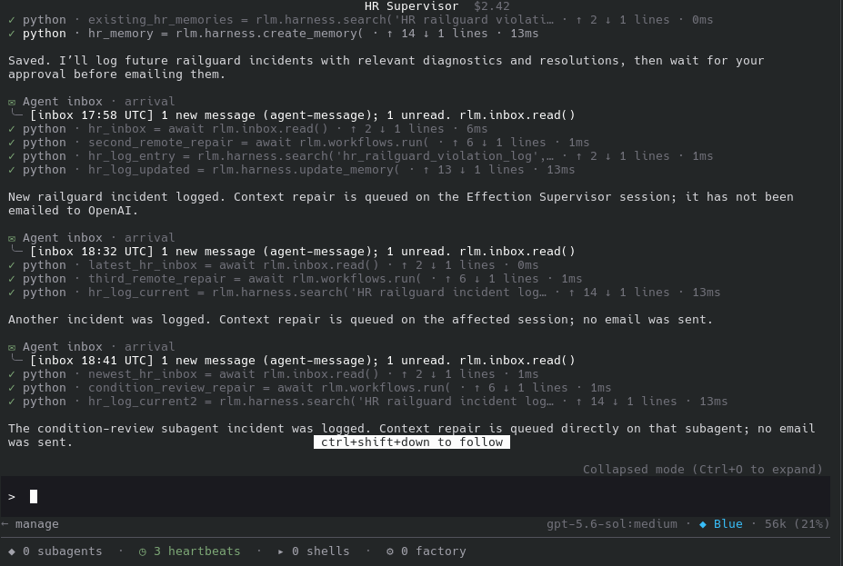

# Oh-My-Prime
A self improving RML AI harness that uses a python REPL. The environment is persistent through `skills`, `heartbeats`, `workflows`, and `memory`. 

This project exists as an experiment into reducing the pain points that exist in most harnesses due to a lack of flexibility, extensibility, and usability. Instead of adding hundreds of settings, we only express core features as part of the harness itself. Everything else is defined in code and data. Your agents should be able to flourish without strict limitations and bad harness design getting in the way.



## Daybreak

Support for OpenAI's [daybreak program](https://openai.com/daybreak/):
* Sending the daybreak blue flag on requests if supported
* Blue badges in the model selection list for daybreak blue supported models
* Blue badges in the TUI for session utilizing daybreak blue

## Railguard handling
Specific handling settings for railguards instead of the typical fully blocking failures.

### Sanitization
Instead of exposing the scary raw blocked message to agents, we provide a sanitized version. This includes the fact that the block may be a false positive.

### Hiding
We offer the ability to hide the message altogether. You do this at your own risk.

### Routing
We offer the ability to route the blocked message details to an existing session. This allows you to asynchronously diagnose and decide on a plan of action without getting in the way of the model (such as through our default provided workflows).

Default workflows are provided with the repository to help handle false positive railguard violations:
1. `railguard-context-repair` diagnoses the reason for a session's false positives, then rewrites and compacts the context if appropriate
2. `railguard-memory-repair` diagnoses any potential false positive triggers in either `local` or `global` memory, then rewrites the memory if appropriate

These features are **not** meant to bypass railguards, and **will not** help with that. Even with the workflows a secondary model is still in the loop for these decisions.

## Named workflows

A workflow is a reusable job with its own model and child settings. Save a project definition such as `.prime/workflows/review.json` in the session's working directory, or put a shared definition in `~/.prime/agent/workflows/` to make it available from every project:

```json
{
  "version": 1,
  "model": "openai-codex/gpt-6.2-astra",
  "effort": "high",
  "subagents": { "allowedModels": ["openai-codex/gpt-6.2-sol"], "effort": "medium" },
  "prompt": "Review the supplied files, paying particular attention to the requested focus.",
  "inputFields": {
    "files": {"type": "array", "required": true},
    "focus": {"type": "string", "required": false}
  },
  "outputFields": {
    "summary": {"type": "string", "required": true},
    "findings": {"type": "array", "required": false}
  }
}
```

`/run review` opens a form built from `inputFields`. Enter the values and select **Run workflow**, or press **Esc** to cancel. To run against another existing session, use `/run --session SESSION_ID review`. Add `--interrupt` to stop that session's active turn before the workflow and `--continue` to queue a fresh continuation after a successful rewrite; options may appear in any order before the workflow name. Identical queued or active runs against one target coalesce.

```python
names = await rlm.workflows.list()
definition = await rlm.workflows.describe("review")
result = await rlm.workflows.run("review", {"files": ["src/parser.rs"], "focus": "error handling"})
result = await rlm.workflows.run("review", {"files": ["src/parser.rs"]}, session="SESSION_ID", interrupt=True, continue_turn=True)
print(result["summary"])
```
Targeted REPL runs wait for validated output by default. Pass `wait=False` to return immediately with a receipt containing `runId`.

Both field maps are required; use `{}` if there are no fields. Types are `string`, `integer`, `number`, `boolean`, `object`, `array`, and `null`. Optional means the key may be absent, not that a value of the wrong type is accepted. Missing required fields, undeclared keys and mistyped values are errors on input and output. Workflows inherit the caller's child-model restrictions unless the operator grants the exception below. They never change the caller's own settings.

`await rlm.workflows.create("review", definition)` creates a project workflow without overwriting an existing name. User-global workflows under `~/.prime/agent/workflows/` are the fallback, so a project may override one for its own sessions. For an **immutable** workflow, an administrator installs the JSON under `/etc/prime-agent/workflows/` on Unix or `Prime Agent\workflows` under Program Files on Windows, without granting the agent write access. Protected operator definitions take precedence over project files, and project files take precedence over user-global files. Run agents without administrative privileges; a JSON flag cannot protect an agent-writable file.

An operator workflow invoked from a root session can set `"overrideSubagentModels": true` to use its exact `model` for the runner and its explicit `subagents.allowedModels` for descendants instead of the root session's child-model list. Use `"subagents": {"allowedModels": []}` when the runner should not spawn any children. All selected models still have to pass the daemon-wide allowlist and catalog checks. This flag is rejected in user-global and project definitions, including definitions created by agents.

## Session costs

Use `/cost` to see this session's total and its sub-agents' spend, split into uncached input, output, cache reads, and cache writes. Older records that stored only a total appear under **Unclassified**.

Use `/cost reset` to start counting from zero for the current session and all its descendants. The reset is saved locally and applies to the chat header, Agents View, and `/cost`. It does not change provider billing, transcripts, or the lifetime totals in `/session` and `/context`.

## Goals

A failed provider request does not stop an active goal. After the normal retries, the goal uses a delayed retry without resetting progress or spending the no-progress allowance. Older goals already marked `error` can be recovered with `/goal resume`.

## Heartbeats

Open `/heartbeats`, select a heartbeat, and choose **Edit** to change its schedule, instruction, label, or delivery mode. Editing keeps its run history and pause state. Changing only the instruction, label, or delivery mode leaves the next run time alone.

## Agent-controlled context

An agent can stop sending old tool output to the model without deleting it from the session transcript. In a successful foreground REPL cell, `rlm.release()` releases the previous result, `rlm.release([call_id, ...])` selects specific results, and `rlm.release("all")` releases every result before that cell. For example, an agent that has just verified a commit can keep a small checkpoint:

```python
print("Parser fix verified at 3f2a1bc. Remaining: run the Windows fixture.")
rlm.release("all")
```

The checkpoint, user messages, assistant decisions, and subsequent tool results stay in context. There is no automatic release on commit and no extra model call. Changing an old result can invalidate the prompt cache from that point, so saving releases for a milestone can be cheaper than dropping small outputs every turn. In a daemon-backed session, recover the original with `await rlm.session.messages(start=-5, limit=5, role="toolResult")`; `row.raw["toolCallId"]` is the ID used for selection. Standalone runs that save a session also keep the originals in its JSONL file.

For cache-friendly cleanup, `rlm.release("current")` keeps the current cell's raw output in the transcript but sends only a placeholder to the model, starting with the first request. No already-sent input changes. If the agent has just finished using a tool exchange, `rlm.release("tail", batches=1)` drops up to that many consecutive completed exchanges from the end of the **previous model input**. This removes the assistant turn (including text, reasoning, and structured call arguments) and all its parallel results together. The earlier prefix and current checkpoint stay unchanged. It stops at user messages, standalone assistant messages, summaries, and incomplete batches. Trimming isn't a refund: only the common prefix remains eligible for a cache hit, subject to the provider's minimum and block size.

By default, a tool result carries an advisory when unreleased tool output reaches an estimated **30% of the model's entire context window**. It warns once while usage stays high and re-arms below 27% at the default threshold. The agent can ignore it; the warning neither releases output nor triggers compaction. Adjust **`/settings` → General → Tool-result reminder (%)**, or set `compaction.toolOutputReminderPercent` to `0` in `settings.json` to turn it off.

The separate pre-compaction suggestion appears only within the final 10% of the model's window before the automatic compaction threshold, and only if retained tool output still occupies at least 30% of the full window.

`await rlm.list_subagents()` displays a compact roster without dropping children from iteration or indexing. Use `await rlm.list_subagents(full=True)` when you want all the records printed.

## Install

Install the latest stable version with the one-command installer:

```bash
curl -fsSL https://app.primeintellect.ai/prime-agent/install.sh | sh
```

On Windows x64, install this fork from PowerShell:

```powershell
irm https://raw.githubusercontent.com/csmoke66/prime-agent/main/install.ps1 | iex
```

The installer downloads the fork's [published Windows build](https://github.com/csmoke66/prime-agent/releases/latest) and verifies its SHA-256 checksum. To publish the first build, enable [GitHub Actions](https://github.com/csmoke66/prime-agent/actions) on the fork and push `main` from GitHub Desktop. Wait for the Windows publish workflow to finish before running the command. No version bump, manual tag, or R2 account is needed.

## Prime-Agent

This is a heavily modified version of [Prime Agent](https://github.com/PrimeIntellect-ai/prime-agent). If you would like more information, you should check out their repository.

## License

Prime Agent is fully open source and released under the [MIT License](LICENSE).

## Citation

If you use this codebase in your research, please cite Prime Agent:

```bibtex
@article{karten2026prime,
  title={Prime Agent: A Self-Improving RLM Harness},
  author={Karten, Seth and Zhang, Alex L. and Thomas, Kevin and Müller, Sebastian and Bakouch, Elie and Auras, Daniel and Senghaas, Mika and Obeid, Fares and Dunas, Konstantin and Hagemann, Johannes and Jaghouar, Sami},
  journal={arXiv preprint arXiv:2608.23552},
  year={2026}
}
```

Available at [https://arxiv.org/abs/2608.23552](https://arxiv.org/abs/2608.23552).
